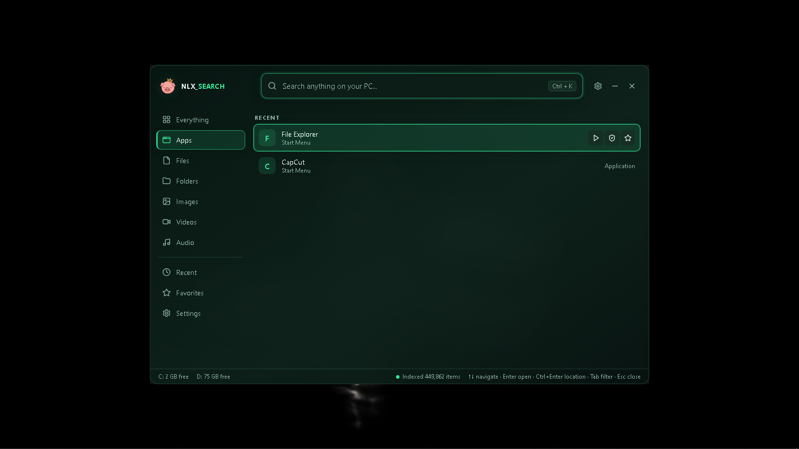

<div align="center">


# 🐷👑 Nlx_Search

### Windows search, but it actually slaps.

[](#)
[](#)
[](https://tauri.app)
[](https://www.rust-lang.org/)
[](#license)
[](#)

*Windows 10's search was designed to punish you.*
*This one isn't.*

**Built for Windows 10.** Not tested on Windows 11 — may or may not behave.

</div>

---

## 🔥 What is this

**NLX_SEARCH** replaces the Windows 10 Start Menu search with something that:

- looks like Spotlight if Spotlight had taste 🖤
- is faster than Windows Search because the bar is set on the floor
- hijacks your `Win` key and makes it actually useful
- has a pig wearing a crown as its logo and no, I will not explain why

It's a dark, glassy, full-width launcher that indexes your apps, files, folders and images — and pops up instantly from a global hotkey instead of the laggy bloated search experience Microsoft shipped.

<div align="center">

</div>

---

## ⚡ Features

- 🎨 **Dark glass UI** — acrylic/transparent background, no gradients, no nonsense
- 🔎 **Full-width results** — no cramped preview panel eating half the window
- ⌨️ **Win key takeover** — press `Win` and get *this* instead of the default Start search
- 🗂️ **Everything, Apps, Files, Folders, Images** — sidebar categories that actually filter
- 📌 **Favorites + recent searches**
- 💽 **Live drive/indexing status** right in the bottom bar
- 🧷 **System tray control** — pause/resume the takeover anytime, no uninstall needed
- 🪶 **Lightweight** — built with Tauri (Rust + native webview), not Electron bloat

---

## 📦 Install

1. Grab the latest `.exe` from [Releases](../../releases)
2. Run it
3. Windows SmartScreen *will* complain the first time — see [⚠️ About the virus warning](#️-about-the-virus-warning) below, it's not what it looks like
4. First launch asks permission to take over the Windows key — accept it, that's the whole point

---

## 🛠️ Build from source

```bash
git clone https://github.com/notlae/nlx-search.git
cd nlx-search
npm install
npm run tauri build
```

Output lands in `src-tauri/target/release/bundle/nsis/`.

Requires:
- Node.js + npm
- Rust toolchain (`rustup`)
- Tauri CLI (`npm run tauri`)

---

## ⚠️ About the "virus" warning

Windows Defender/SmartScreen flags this as "potentially unwanted software" because:

- the installer isn't code-signed (that costs money I don't have 💸)
- it installs a global low-level keyboard hook, which is exactly the kind of thing malware does too

**It is not a keylogger.** The hook only checks for the `Win` key (and `Win+S` / `Win+Q`) to swap in this launcher instead of the default Start menu — it doesn't log, store, or transmit any keystrokes. The source is public right here, read `src-tauri/src/hook.rs` yourself.

If you don't trust a random pig-logo exe from the internet (correct instinct, generally), build it from source instead — see above. 🐷

---

## 🐽 Why a pig

Cause Technoblade Never Dies !!.

So Dont say just pig Say legend !!

---
## 📥 Download & Install

Get the latest version of **NLX_SEARCH** from the GitHub Releases page.

1. Visit [NLX_SEARCH Releases](https://github.com/notlae/Nlx_Search/releases).
2. Download the latest Windows `.exe` installer.
3. Run the installer and follow the on-screen instructions.
4. Launch NLX_SEARCH and enjoy a faster Windows search experience! 🐷

> **Note:** Windows SmartScreen may display a security warning because the application is not code-signed. Only install builds you trust.

---
## 🧷 Keyboard takeover notes

- `Win` alone → opens NLX_SEARCH
- `Win + S` / `Win + Q` → also opens NLX_SEARCH (matches muscle memory from native search)
- `Win + Shift + S`, `Win + L`, `Win + D`, etc. → untouched, work exactly like normal Windows
- `Alt + Space` → fallback hotkey, works even if takeover is paused
- Takeover can be paused/resumed anytime from the tray icon — no restart needed, no reinstall, no drama

---

## 🤝 Contributing

Found a bug? Got an idea? Open an issue or a PR. This is a solo side project built for fun and out of genuine hatred for Windows 10 search, so go easy, but PRs are welcome.
                                                                            OR
Message me on [Instagram](https://www.instagram.com/biren_shrestha17/) , [Protofoilo](https://www.notlae.is-a.dev/)

---
## Sponcer
Made with Claude and Chatgpt 

## 📜 License

MIT — do whatever you want with it, just don't blame me if the pig judges you.

<div align="center">
*made with 🐷, Rust, and mild rage at Windows 10 search*

</div>
